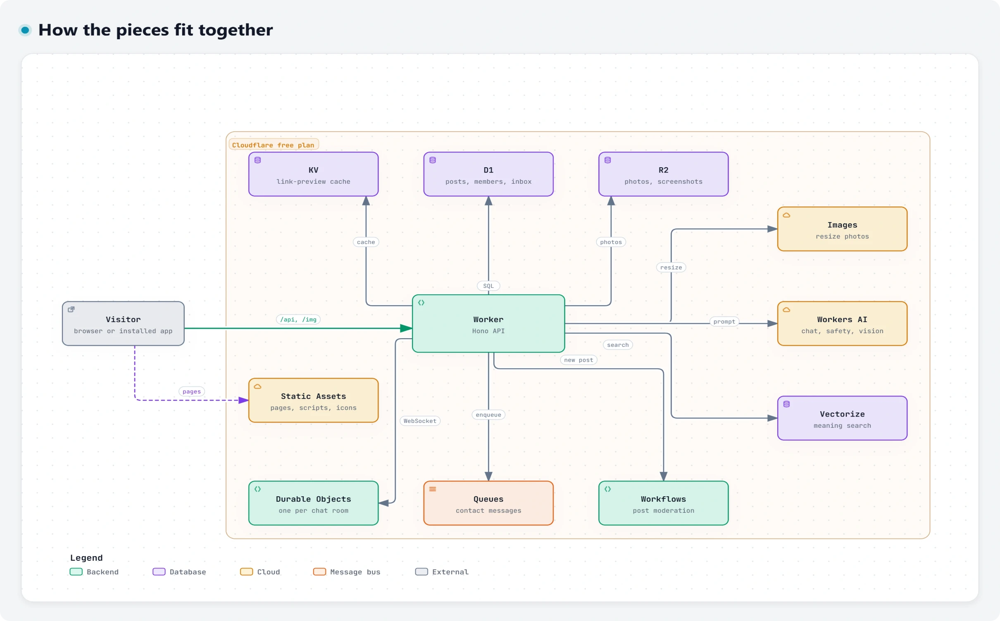

<div align="center">


<h1>Cloudflare Free</h1>

<p><strong>A website and installable app built only from Cloudflare's free tier,<br>with the goal of using every free thing Cloudflare offers.</strong></p>

<picture>
  <source media="(prefers-color-scheme: dark)" srcset="docs/images/score-dark.png">
  
</picture>

<p><sub>Not deployed yet: the live demo goes up once the Cloudflare account and domain are ready.</sub></p>

<p>
  <a href="#whats-inside">What's&nbsp;inside</a>&nbsp;&nbsp;·&nbsp; <a href="docs/how-it-works.md">How&nbsp;it&nbsp;works</a>&nbsp;&nbsp;·&nbsp; <a href="#run-it-locally">Run&nbsp;it&nbsp;locally</a>&nbsp;&nbsp;·&nbsp; <a href="#deploy-it-for-free">Deploy&nbsp;it&nbsp;for&nbsp;free</a>&nbsp;&nbsp;·&nbsp; <a href="docs/research/free-tier-report.md">The&nbsp;research</a>
</p>

<br>

<picture>
  <source media="(prefers-color-scheme: dark)" srcset="docs/images/hero-dark.webp">
  
</picture>

</div>

## What's inside

| | What you get |
|---|---|
| 🏆&nbsp;**Showcase** | A scoreboard of 82 free Cloudflare offerings, and a Lab with AI chat, image generation, link previews, screenshots, DNS lookups and verifiable dice |
| 💬&nbsp;**Community** | Passkey sign-in with no passwords, photo posts whose text and picture an AI Workflow checks, and live chat rooms |
| ✍️&nbsp;**Personal&nbsp;site** | A blog with search that matches on meaning, a contact form with a human check, and an admin inbox for messages and email |

<picture>
  <source media="(prefers-color-scheme: dark)" srcset="docs/images/tour-dark.webp">
  
</picture>

<p align="center"><sub>The demo members are the cast of HBO's <i>Silicon Valley</i>. <code>npm run demo</code> adds them to your local copy.</sub></p>

## How the free products fit together

<picture>
  <source media="(prefers-color-scheme: dark)" srcset="docs/images/diagrams/overview-dark.webp">
  
</picture>

<p align="center"><b><a href="docs/how-it-works.md">How it works</a></b> has a diagram like this for every piece: sign-in, photos, posting, chat, the AI assistant, email and more.</p>

| Feature | Cloudflare products |
|---|---|
| Installable web app | Workers Static Assets (unlimited free asset requests), service worker, web manifest |
| API | Workers + Hono, Smart Placement, Rate Limiting binding, version metadata |
| Accounts | Passkeys (WebAuthn) verified in the Worker, HMAC-signed session cookies, Turnstile on sign-up |
| Posts and photos | D1 (posts, members), R2 (photos), Images binding (three fixed widths), Cache API |
| Moderation | Workflows: vision-model description of the photo, Llama Guard safety check of the text and that description, bge embeddings into Vectorize, publish |
| Chat | One SQLite Durable Object per room, WebSocket Hibernation, auto-response heartbeats |
| AI assistant and Lab | Workers AI (GLM-4.7 Flash, FLUX.1 schnell, Markdown conversion), optional AI Gateway, Browser Run screenshots |
| Link previews | Worker fetch + HTMLRewriter, cached in KV for a week |
| Contact form | Turnstile, Queues (with a dead-letter queue), D1, send-email binding to your own address |
| Inbound email | Email Routing to an Email Worker, parsed into the admin inbox |
| Insights | Workers Analytics Engine events, Workers Logs, Traces and Issues, nightly Cron Trigger rollup into D1 |
| Public tools | 1.1.1.1 DNS over HTTPS, Cloudflare Status API, drand randomness beacon, `request.cf` edge data |

The full list, with each offering's free allowance and status, is in [app/src/shared/catalog.ts](app/src/shared/catalog.ts) and on the site's Scoreboard page. It comes from [the research report](docs/research/free-tier-report.md), checked on 2026-10-14, with notes per area in [docs/research/notes](docs/research/notes).

## Staying inside the free allowances

| Budget | Free allowance | How this project stays inside it |
|---|---|---|
| Worker requests | 100,000 a day | Pages, scripts and icons are static assets, which never run the Worker. Only `/api/*`, `/img/*` and `security.txt` do, so a photo costs one request the first time each browser loads it, and repeats within the hour come from the browser's cache. |
| CPU time | 10 ms per request | Passkeys instead of password hashing, which wouldn't fit. |
| KV writes | 1,000 a day | Sessions are signed cookies, not KV entries. KV only caches link previews, after a rate-limit check and at most 500 a day. |
| Image transformations | 5,000 a month | Only 320, 640 and 1280 px widths, so each photo uses at most three. The vision step reuses the 640 px size, and results are edge-cached. |
| Workers AI | 10,000 Neurons a day | Small models, thinking off, short answers and per-visitor limits. When the day's budget runs out, the site says it resets at midnight UTC. Image generation and chat stop at 6,000 Neurons a day, so moderation always has budget left. |
| Browser Run | 10 minutes a day, 1 screenshot every 10 seconds | Screenshots are for signed-in members only, rate limited, and stored in R2 so each page is captured once. |
| Durable Objects | 100,000 requests and 13,000 GB-s a day | Quiet rooms hibernate, so open sockets spend no GB-s, and heartbeat pings are answered without waking them. Incoming chat messages count as requests at 20 to 1, and each member can send one a second. |
| Logs and traces | 200,000 log events a day; from 1 December 2026, 0.5 GB a day shared with traces | Every request is logged and traced; lower the head sampling rate in the Wrangler config if the pool fills, since Free stops ingesting at the cap until 00:00 UTC. |

## Run it locally

Needs Node.js 22.18 or newer.

```bash
cd app
npm install
npm run setup
npm run dev
```

Then open http://localhost:5173. `npm run setup` creates `.dev.vars` (git-ignored) with a random session secret and Cloudflare's always-pass Turnstile test secret, then creates the local database tables.

Everything runs locally with no Cloudflare account, including D1, KV, R2, Queues, Durable Objects and Workflows. Workers AI only exists on Cloudflare's network, so locally the AI tools say so, and new posts are published without AI checks (marked "local dev"). After `npx wrangler login`, `npm run dev:remote` reaches Workers AI; Vectorize search and Browser Run screenshots work once deployed.

Run `npm run demo` in a second terminal while `npm run dev` is running to add the demo community. To get the Admin page locally, sign up, copy the member id shown on your Account page into `ADMIN_USER_IDS` in `app/.dev.vars`, then restart `npm run dev`.

| More commands, run in `app/` | What they do |
|---|---|
| `npm run demo` | Fills your local copy with the demo community: members, photo posts and chat |
| `npm run check` | Typecheck, tests and build in one go; run it before every push |
| `npm test` | Runs the test suite inside workerd, with the AI steps mocked |
| `npm run typecheck` | Type-checks the Worker, the web app, the tests and the scripts |
| `npm run readme:images` | Retakes the pictures in this README from the running site, in light and dark |
| `npm run diagrams:images` | Saves each diagram in `public/learn` as light and dark pictures for the guide |

## Deploy it for free

<details>
<summary><b>First deploy, on a free workers.dev address</b></summary>
<br>

Run these in `app/`.

1. Log in to Cloudflare:

   ```bash
   npx wrangler login
   ```

2. In the dashboard, open **R2** and enable it. Cloudflare may ask for a payment method; the free allowance is 10 GB-month.
3. Create the search index once. It needs 384 dimensions to match `bge-small-en-v1.5`:

   ```bash
   npx wrangler vectorize create cloudflare-free-search --dimensions=384 --metric=cosine
   ```

4. Create a **Turnstile** widget in the dashboard (free). Put its site key in `TURNSTILE_SITE_KEY` in `app/wrangler.jsonc`, replacing the test key.
5. Deploy. Wrangler creates the D1 database, KV namespace, R2 bucket and queues on the first deploy, and the deploy script then applies the database schema:

   ```bash
   npm run deploy
   ```

6. Add the secrets:

   ```bash
   npx wrangler secret put SESSION_SECRET
   npx wrangler secret put TURNSTILE_SECRET_KEY
   ```

7. Open the site, sign up, and copy the member id shown on your Account page. Put it in `ADMIN_USER_IDS` in `app/wrangler.jsonc` and run `npm run deploy` again. Admin rights go by member id, so nobody can claim them by picking a username first.

Optional, still without a domain:

- **AI Gateway:** create a gateway and put its id in `AI_GATEWAY_ID` for caching, rate limits and logs on AI calls.
- **Web Analytics:** add a site and put its token in `WEB_ANALYTICS_TOKEN`.
- **Workers Builds:** connect this repo to the Worker in the dashboard with root directory `app`, build command `npm run check` and deploy command `npx wrangler deploy && npm run db:migrate:remote`, for push-to-deploy with preview URLs.
- **Notifications:** add email or webhook alerts for Worker errors and DDoS events.

**Note:** passkeys belong to the hostname that created them, so accounts made on workers.dev won't carry over to your domain. Create your real account after the domain step. Then put the new account's id in `ADMIN_USER_IDS`.

</details>

<details>
<summary><b>When the domain is on Cloudflare</b></summary>
<br>

These switch on everything marked **Needs domain** on the scoreboard. Each is free on the Free plan.

1. Add the domain to Cloudflare, switch the nameservers, then turn on DNSSEC.
2. Serve the Worker on it: add `"routes": [{ "pattern": "example.com", "custom_domain": true }]` to `app/wrangler.jsonc` and deploy.
3. **Email:**
   - Enable Email Routing and verify your own address as a destination.
   - Route an address such as `hello@` to the `cloudflare-free` Worker.
   - Add a `send_email` binding named `NOTIFY_EMAIL`, plus the `OWNER_EMAIL` and `NOTIFY_FROM` vars.
   - Turn on DMARC Management.
4. **Security:**
   - The Free Managed Ruleset and DDoS protection are already on.
   - Add WAF custom rules (5 free) and the one rate-limiting rule, for example on `/api/auth/*`.
   - Turn on AI bot policies, AI Labyrinth and managed robots.txt.
   - Turn on HSTS, minimum TLS 1.2, Certificate Transparency Monitoring, Security Insights, Client-side security, and API Shield schema validation.
5. **Speed and rules:**
   - Turn on HTTP/3, Early Hints and Speed Brain.
   - Long-lived caching for `/assets/*` and the security headers already come from `app/public/_headers`, on workers.dev too.
   - Add a www-to-apex redirect.
6. **Zaraz and Observatory:** consent-managed tags and real-user monitoring.
7. **Access (needs a card on file):** protect `/admin` with a Zero Trust Access application for your own email.

</details>

## Project layout

```text
app/                 The website and its Worker; run npm commands here
├─ src/worker/       Hono API, Durable Object, Workflow, queue, cron and email handlers
├─ src/client/       React web app: pages, components, passkey sign-in
├─ src/shared/       The catalog of free offerings, and types both sides share
├─ migrations/       D1 schema
├─ public/           Manifest, service worker, icons, _headers; learn/ holds the diagrams
├─ test/             Vitest suites that run inside workerd
└─ scripts/          Local setup, demo data, icons and the pictures in docs
docs/
├─ how-it-works.md   A diagram and a short explanation for each piece
├─ CONTRIBUTING.md   How to work on it; SECURITY.md and CHANGELOG.md sit alongside
├─ diagrams/         The diagrams' JSON sources
├─ research/         The free-tier research report and notes
└─ images/           Pictures for the README and the guide
```

<br>

<p align="center"><sub>
<a href="docs/CONTRIBUTING.md">Contributing</a> · <a href="docs/SECURITY.md">Security</a> · <a href="docs/CHANGELOG.md">Changelog</a><br>
Built with <a href="https://hono.dev">Hono</a>, <a href="https://react.dev">React</a>, <a href="https://simplewebauthn.dev">SimpleWebAuthn</a> and <a href="https://github.com/postalsys/postal-mime">postal-mime</a>. Diagrams drawn with <a href="https://github.com/tt-a1i/archify">Archify</a> (MIT, <a href="app/public/learn/NOTICES.txt">notices</a>). Demo photos are AI-generated; demo members are characters from HBO's <i>Silicon Valley</i>.<br>
Unofficial project, not affiliated with Cloudflare.
</sub></p>
