

<h1>How it works</h1>

<strong>One diagram for each piece of Cloudflare Free: what runs where, in what order, and which free product does each job.</strong>

  <a href="#the-big-picture">The&nbsp;big&nbsp;picture</a>&nbsp;&nbsp;·&nbsp; <a href="#members-and-posts">Members&nbsp;and&nbsp;posts</a>&nbsp;&nbsp;·&nbsp; <a href="#chat-and-ai">Chat&nbsp;and&nbsp;AI</a>&nbsp;&nbsp;·&nbsp; <a href="#messages-and-numbers">Messages&nbsp;and&nbsp;numbers</a>

Every picture here also comes as an interactive page you can zoom, search, trace and export. Run the site (`npm run dev` in `app/`) and open **How it works**, or open any file in [`app/public/learn`](../app/public/learn) in a browser. The diagrams are written as JSON in [`docs/diagrams`](diagrams) and drawn with [Archify](https://github.com/tt-a1i/archify).

## The big picture

### How the pieces fit together

<picture>
  <source media="(prefers-color-scheme: dark)" srcset="images/diagrams/overview-dark.webp">
  
</picture>

Pages, scripts and icons come from Workers Static Assets, which is free and never runs the Worker. Only `/api/*`, `/img/*` and `security.txt` reach the Worker, a Hono app that reaches every other product through a binding. Slow work leaves the request: a Queue takes contact messages and a Workflow checks each new post.

- **Free products:** Workers Static Assets, Workers, D1, KV, R2, Durable Objects, Queues, Workflows, Images, Workers AI, Vectorize
- **Code:** [`wrangler.jsonc`](../app/wrangler.jsonc) (every binding), [`app.ts`](../app/src/worker/app.ts) (routes), [`index.ts`](../app/src/worker/index.ts) (handlers)
- **Diagram:** [`overview.json`](diagrams/overview.json), interactive at `/learn/overview.html`

### Pages and the installable app

<picture>
  <source media="(prefers-color-scheme: dark)" srcset="images/diagrams/pages-dark.webp">
  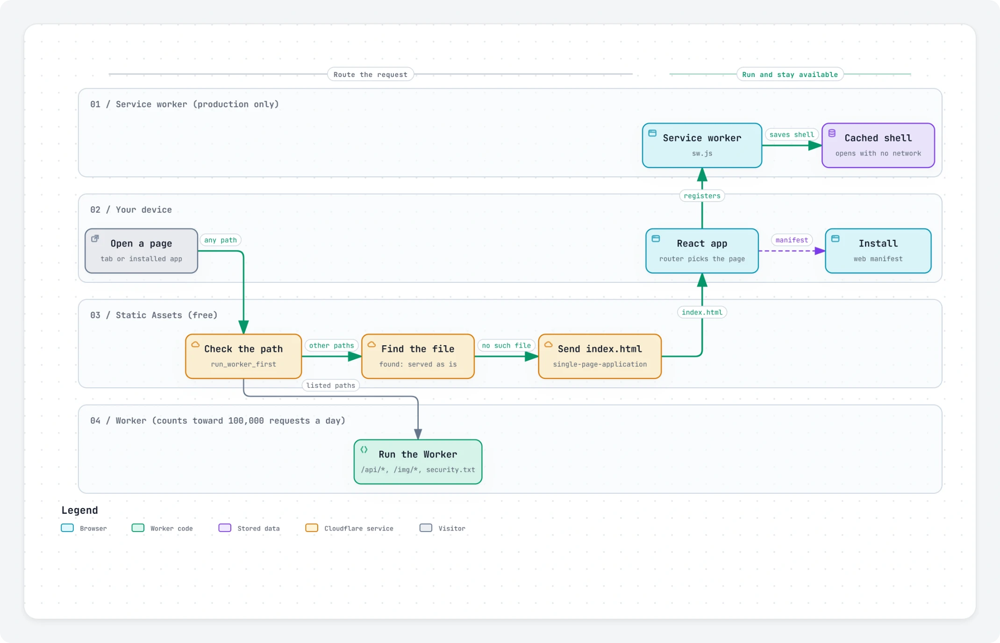
</picture>

Only `/api/*`, `/img/*` and `security.txt` run the Worker, which counts toward the free 100,000 requests a day. Every other path is answered by Static Assets, free and unlimited: a file that exists is sent as is, and anything else gets `index.html`, so the React router picks the page. In production a service worker saves the app shell so the app opens offline, and the web manifest makes it installable.

- **Free products:** Workers Static Assets, Workers
- **Code:** [`wrangler.jsonc`](../app/wrangler.jsonc) (`assets`), [`sw.js`](../app/public/sw.js), [`manifest.webmanifest`](../app/public/manifest.webmanifest), [`router.tsx`](../app/src/client/router.tsx)
- **Diagram:** [`pages.json`](diagrams/pages.json), interactive at `/learn/pages.html`

## Members and posts

### Signing in with a passkey

<picture>
  <source media="(prefers-color-scheme: dark)" srcset="images/diagrams/sign-in-dark.webp">
  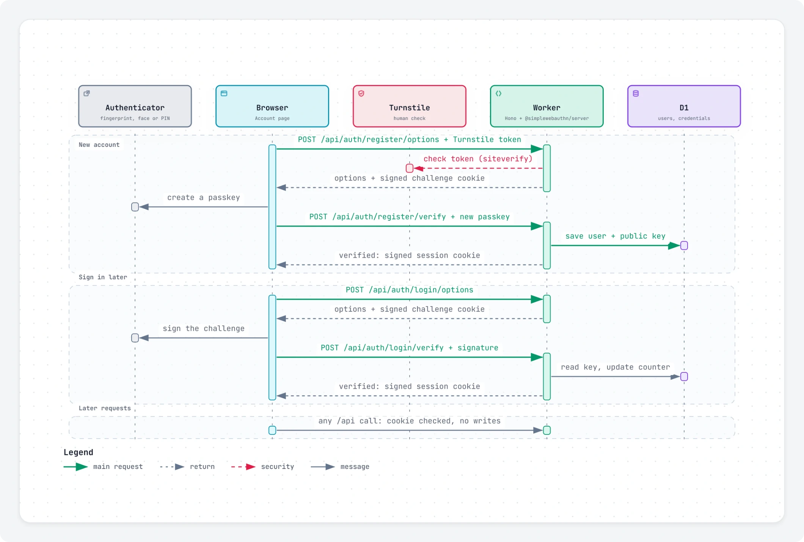
</picture>

Sign-up passes Turnstile and a rate limit, then the Worker sends a one-time WebAuthn challenge, kept in a signed cookie for five minutes. On sign-up the device makes a passkey and D1 stores only its public key; on sign-in the passkey signs the challenge, and checking that signature fits inside the Free plan's 10 ms of CPU time. The Worker then sets a signed session cookie for 30 days, so later requests read one row and write nothing.

- **Free products:** Turnstile, Rate Limiting, D1, Workers
- **Code:** [`routes/auth.ts`](../app/src/worker/routes/auth.ts), [`lib/session.ts`](../app/src/worker/lib/session.ts), [`pages/Account.tsx`](../app/src/client/pages/Account.tsx)
- **Diagram:** [`sign-in.json`](diagrams/sign-in.json), interactive at `/learn/sign-in.html`

### Uploading and serving photos

<picture>
  <source media="(prefers-color-scheme: dark)" srcset="images/diagrams/photos-dark.webp">
  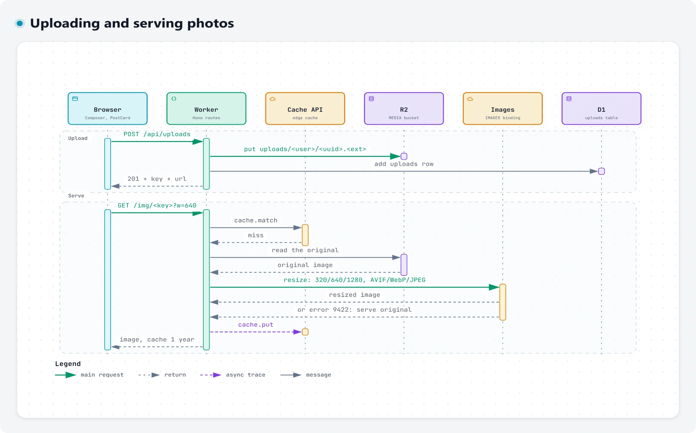
</picture>

An upload of up to 8 MB goes into R2 once the Images binding confirms it really is an image, and a row in D1 records who owns it. Each member can upload 20 photos or 50 MB a day. Photos are served from `/img/` at 320, 640 or 1280 px: on a cache miss the Worker reads the original from R2, the Images binding resizes it to AVIF, WebP or JPEG, and the Cache API keeps the result for an hour. That caps each photo at 3 of the 5,000 free transformations a month, and if a resize fails the original is served. Because cached copies last only an hour, a rejected post's photo soon stops being served, and its `/img/` address returns 404.

- **Free products:** R2, Images, Cache API, D1, Rate Limiting
- **Code:** [`routes/media.ts`](../app/src/worker/routes/media.ts), [`components/Composer.tsx`](../app/src/client/components/Composer.tsx)
- **Diagram:** [`photos.json`](diagrams/photos.json), interactive at `/learn/photos.html`

### Posting a photo

<picture>
  <source media="(prefers-color-scheme: dark)" srcset="images/diagrams/posting-dark.webp">
  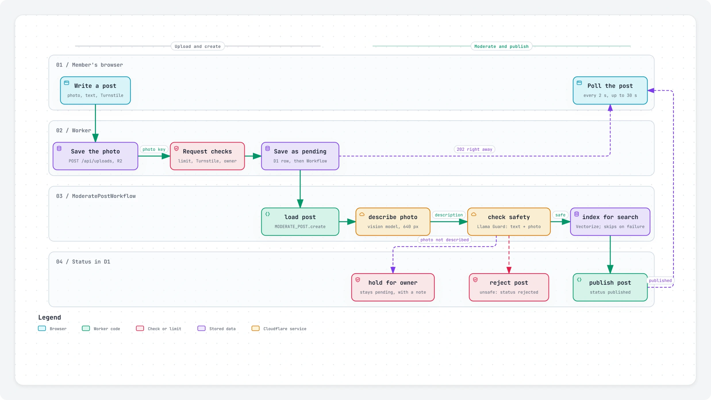
</picture>

The photo goes into R2 first. The post then passes a rate limit, Turnstile and a check that the photo is the member's own, is saved as pending in D1, and gets an answer at once. The moderation Workflow first has a vision model describe the photo, then Llama Guard checks the text and that description together: an unsafe post is rejected, a photo that can't be described waits for the owner, and a safe post gets its alt text and a search entry before it is published, while the browser checks back every 2 seconds for up to 30.

- **Free products:** Workflows, Workers AI, Vectorize, R2, D1, Images, Turnstile, Rate Limiting
- **Code:** [`routes/posts.ts`](../app/src/worker/routes/posts.ts), [`workflows/moderate-post.ts`](../app/src/worker/workflows/moderate-post.ts), [`components/Composer.tsx`](../app/src/client/components/Composer.tsx)
- **Diagram:** [`posting.json`](diagrams/posting.json), interactive at `/learn/posting.html`

### A post's journey

<picture>
  <source media="(prefers-color-scheme: dark)" srcset="images/diagrams/post-lifecycle-dark.webp">
  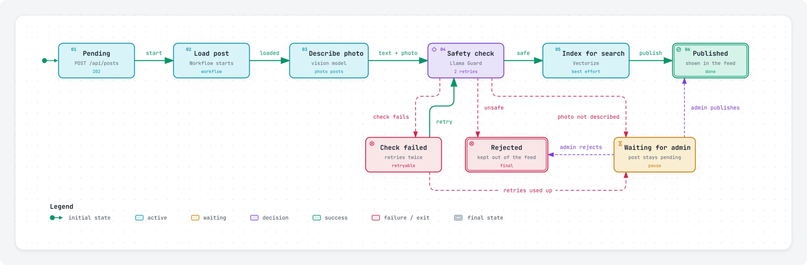
</picture>

Every post starts as pending. The Workflow loads it, has a vision model describe the photo, and runs the safety check on the title, body and description, retrying twice if the check fails. Unsafe posts are rejected; safe ones get a search entry and are published. A photo that can't be described, retries that run out or a Workflow that can't start leave the post pending until the owner publishes or rejects it on the Admin page. The Workflow only changes a post that is still pending, so it never overwrites the owner's decision. In local dev, where Workers AI isn't available, posts are published with the note "Published without AI checks (local dev)".

- **Free products:** Workflows, D1
- **Code:** [`workflows/moderate-post.ts`](../app/src/worker/workflows/moderate-post.ts), [`routes/admin.ts`](../app/src/worker/routes/admin.ts), [`0001_init.sql`](../app/migrations/0001_init.sql)
- **Diagram:** [`post-lifecycle.json`](diagrams/post-lifecycle.json), interactive at `/learn/post-lifecycle.html`

## Chat and AI

### Live chat in a Durable Object

<picture>
  <source media="(prefers-color-scheme: dark)" srcset="images/diagrams/chat-dark.webp">
  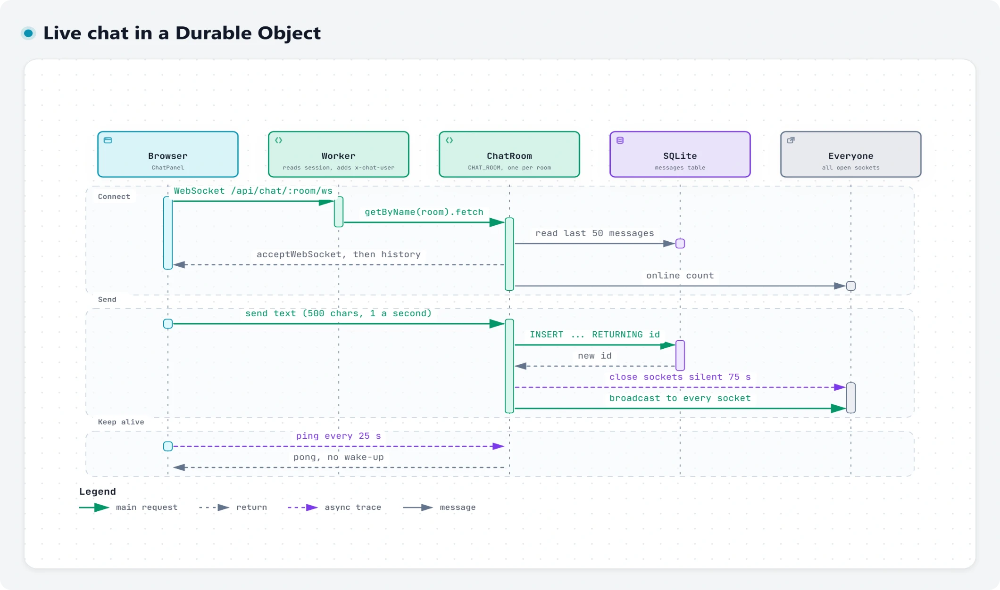
</picture>

The Worker reads the session and hands the WebSocket to the room's Durable Object, along with who is connecting. The room sends the last 50 messages, saves new ones in its own SQLite database and broadcasts them to everyone online. Each member can send one message a second, counted across all their tabs, and keep up to 3 tabs open in a room, where opening a 4th closes the oldest. Thanks to WebSocket Hibernation, a quiet room leaves memory, and heartbeat pings are answered without waking it.

- **Free products:** Durable Objects (SQLite storage, WebSocket Hibernation), Workers
- **Code:** [`routes/chat.ts`](../app/src/worker/routes/chat.ts), [`durable/chat-room.ts`](../app/src/worker/durable/chat-room.ts), [`components/ChatPanel.tsx`](../app/src/client/components/ChatPanel.tsx)
- **Diagram:** [`chat.json`](diagrams/chat.json), interactive at `/learn/chat.html`

### Asking the AI assistant

<picture>
  <source media="(prefers-color-scheme: dark)" srcset="images/diagrams/assistant-dark.webp">
  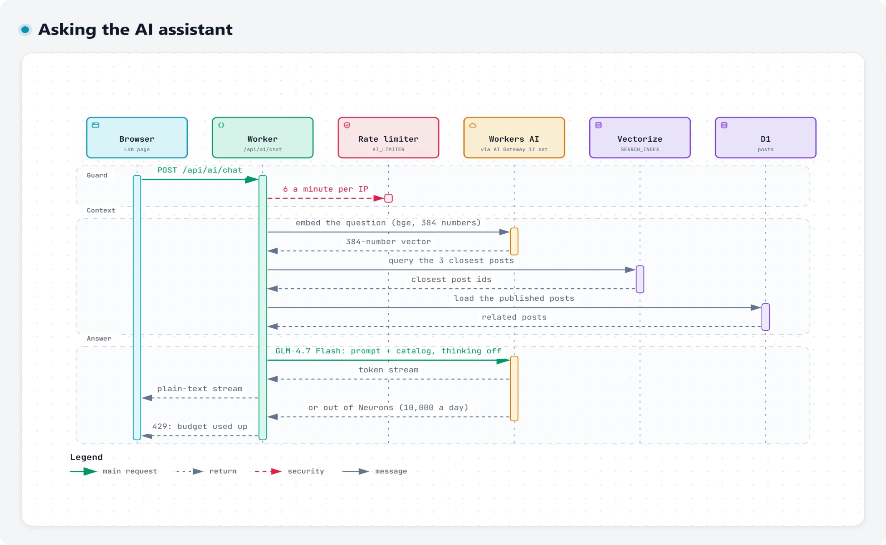
</picture>

Each question passes a per-visitor limit, then bge-small turns it into a vector, Vectorize finds the three closest posts, and D1 supplies their text. The Worker adds those posts and the product list to the prompt, and GLM-4.7 Flash streams the answer back as plain text. Every model call shares the free 10,000 Neurons a day, and chat and image generation stop at 6,000 so moderation always has some left; when the budget runs out, the Worker says so until midnight UTC.

- **Free products:** Workers AI, Vectorize, D1, Rate Limiting, AI Gateway (optional)
- **Code:** [`routes/ai.ts`](../app/src/worker/routes/ai.ts), [`lib/ai.ts`](../app/src/worker/lib/ai.ts), [`pages/Lab.tsx`](../app/src/client/pages/Lab.tsx)
- **Diagram:** [`assistant.json`](diagrams/assistant.json), interactive at `/learn/assistant.html`

### The Lab's tools

<picture>
  <source media="(prefers-color-scheme: dark)" srcset="images/diagrams/lab-tools-dark.webp">
  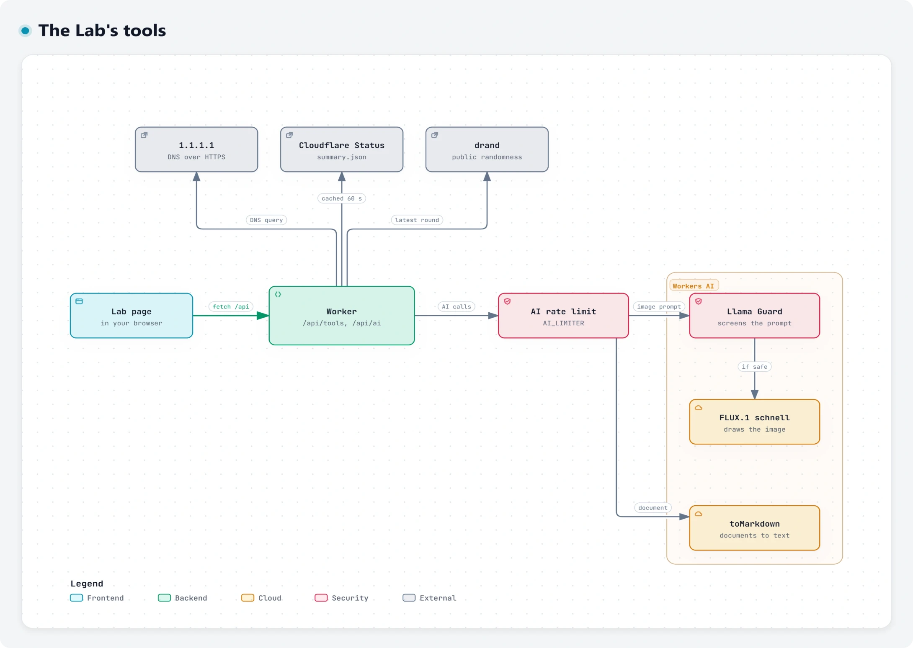
</picture>

The public tools need no keys: DNS answers come from 1.1.1.1 over HTTPS, Cloudflare's status is cached for 60 seconds, and dice rolls use a drand round anyone can verify. Each AI tool allows 6 calls a minute per visitor, and all of them share the free 10,000 Neurons a day; image prompts pass Llama Guard before FLUX.1 schnell draws them. The edge card reads `request.cf` to show which data center answered.

- **Free products:** Workers AI, Rate Limiting, 1.1.1.1, Cloudflare Status API, drand
- **Code:** [`routes/tools.ts`](../app/src/worker/routes/tools.ts), [`routes/ai.ts`](../app/src/worker/routes/ai.ts), [`pages/Lab.tsx`](../app/src/client/pages/Lab.tsx)
- **Diagram:** [`lab-tools.json`](diagrams/lab-tools.json), interactive at `/learn/lab-tools.html`

### Link previews and screenshots

<picture>
  <source media="(prefers-color-scheme: dark)" srcset="images/diagrams/link-preview-dark.webp">
  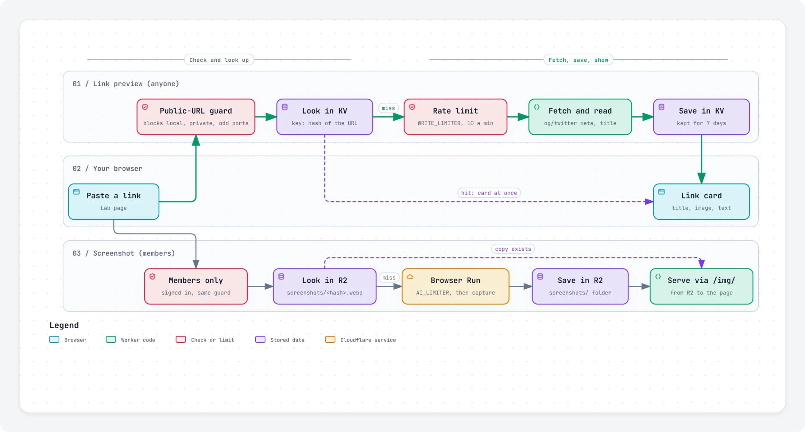
</picture>

Every link first passes a guard that refuses local and private addresses, and a preview already in KV comes back at once. Otherwise, after a rate limit, the Worker reads the page's head with HTMLRewriter and caches the card in KV for a week, so each link is written at most once a week. KV allows 1,000 free writes a day, and the site stops caching new cards after 500 in a day. Signed-in members can also ask for a screenshot: Browser Run captures the page once, R2 keeps it, and `/img/` serves it.

- **Free products:** KV, HTMLRewriter, Browser Run, R2, Rate Limiting, Workers
- **Code:** [`routes/tools.ts`](../app/src/worker/routes/tools.ts), [`lib/preview.ts`](../app/src/worker/lib/preview.ts), [`pages/Lab.tsx`](../app/src/client/pages/Lab.tsx)
- **Diagram:** [`link-preview.json`](diagrams/link-preview.json), interactive at `/learn/link-preview.html`

## Messages and numbers

### Sending a contact message

<picture>
  <source media="(prefers-color-scheme: dark)" srcset="images/diagrams/contact-dark.webp">
  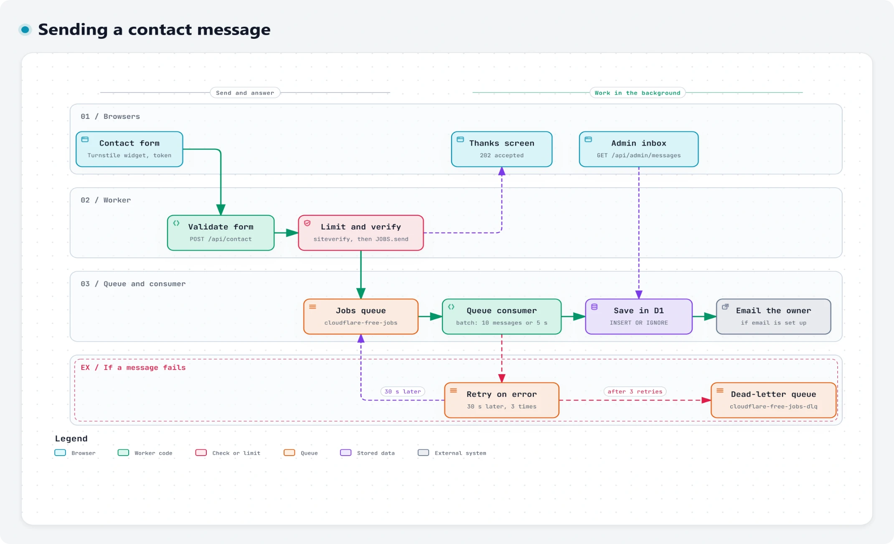
</picture>

The form passes a rate limit and Turnstile, goes onto a Queue, and the visitor sees a thank-you right away. The queue consumer takes up to 10 messages at a time, saves each in D1, where saving twice does no harm, and emails the owner once email is set up. A failed message is retried after 30 seconds, up to 3 times, then lands in a dead-letter queue.

- **Free products:** Queues, D1, Turnstile, Rate Limiting, Email Routing
- **Code:** [`routes/contact.ts`](../app/src/worker/routes/contact.ts), [`handlers.ts`](../app/src/worker/handlers.ts), [`pages/Contact.tsx`](../app/src/client/pages/Contact.tsx)
- **Diagram:** [`contact.json`](diagrams/contact.json), interactive at `/learn/contact.html`

### Email in and out

<picture>
  <source media="(prefers-color-scheme: dark)" srcset="images/diagrams/email-dark.webp">
  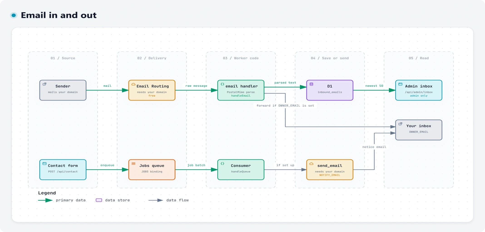
</picture>

Email Routing hands mail for the domain to the Worker's `email` handler, which forwards it to the owner first, so a failed save never loses mail, then parses it and saves the text in D1 for the admin inbox. In the other direction, the contact form's queue consumer emails the owner through the `send_email` binding. Both need the domain on Cloudflare; without it, contact messages are still saved.

- **Free products:** Email Routing, Email Workers, `send_email`, Queues, D1
- **Code:** [`handlers.ts`](../app/src/worker/handlers.ts), [`routes/admin.ts`](../app/src/worker/routes/admin.ts), [`pages/Admin.tsx`](../app/src/client/pages/Admin.tsx)
- **Diagram:** [`email.json`](diagrams/email.json), interactive at `/learn/email.html`

### Usage insights and the nightly rollup

<picture>
  <source media="(prefers-color-scheme: dark)" srcset="images/diagrams/insights-dark.webp">
  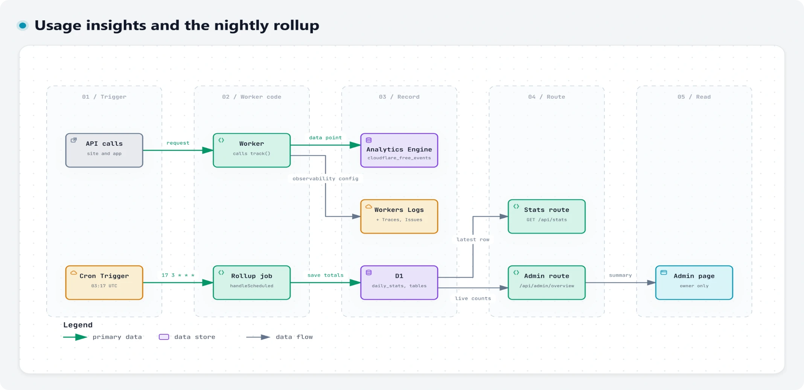
</picture>

Each route writes one Analytics Engine data point per event, such as a sign-up, a post or a search, and Workers Logs, Traces and Issues need only the `observability` setting. Every night at 03:17 UTC a Cron Trigger counts members, posts and messages in D1 and saves the totals, which `/api/stats` serves; the Admin page counts the live tables instead. The optional Web Analytics beacon adds page views, without cookies.

- **Free products:** Workers Analytics Engine, Cron Triggers, D1, Workers Logs, Traces and Issues, Web Analytics
- **Code:** [`lib/analytics.ts`](../app/src/worker/lib/analytics.ts), [`handlers.ts`](../app/src/worker/handlers.ts), [`routes/meta.ts`](../app/src/worker/routes/meta.ts)
- **Diagram:** [`insights.json`](diagrams/insights.json), interactive at `/learn/insights.html`

 

<a href="../README.md">Back to the README</a>

